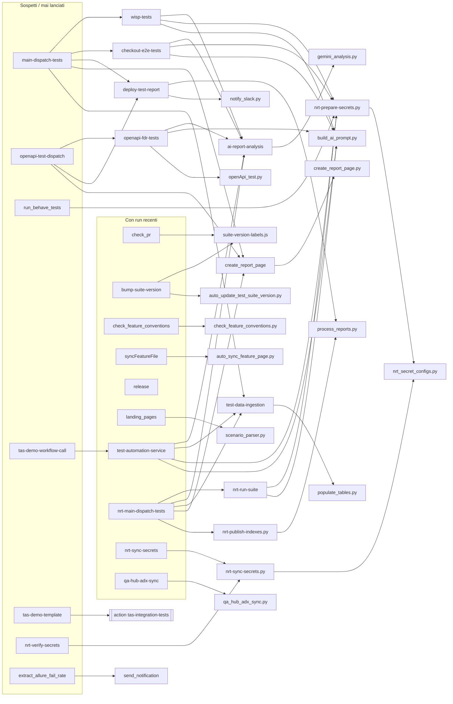

# Mappa di utilizzo delle GitHub Action (`.github/workflows`, `.github/actions`, `.github/scripts`)

Documento di lavoro, generato il 2026-11-25 con sole letture (`gh run list`, `gh workflow list`, `gh api`) e analisi statica dei file. Nessun workflow o script è stato modificato, disabilitato o rilanciato.

## 1. Metodo e limiti

- Run lette con `gh run list --workflow <id> --limit 1000`. La run più vecchia visibile nel repository è del 2026-01-01, quindi "ultimi 12 mesi" coincide con "totale visibile". Le run precedenti sono assenti, probabilmente per la retention: non si può dire nulla su di esse.
- **Un workflow chiamato via `workflow_call` non ha run proprie.** Le sue esecuzioni compaiono come job della run del chiamante (es. `trigger_wisp / wisp_tests`). Un "0 run" su un reusable workflow quindi **non** significa inutilizzato. L'uso indiretto è stato ricostruito dai job delle run dei chiamanti.
- Gli eventi `push` su workflow che non hanno un trigger `push` sono run di test su feature branch da versioni precedenti del file (il trigger poi è stato rimosso) oppure run fallite in fase di parsing. Non sono uso reale.
- **Non determinabile dalle run**: l'uso da altri repository tramite `uses: pagopa/pagopa-platform-integration-test/...@ref`. `gh search code` sull'org `pagopa` vede solo riferimenti dentro questo repo (altri repo privati potrebbero non essere indicizzati o visibili). Per `test-automation-service.yml` esiste però evidenza indiretta forte (vedi sotto). Per gli altri workflow non si può escludere un uso esterno.
- Anche il `workflow_dispatch` lanciato via API da bot/CI di altri repo si vede solo come `actor`, non come repo sorgente.
- Esistono workflow gestiti da GitHub (Copilot, Dependabot, CodeQL, Dependency Graph, pages-build-deployment, Automatic Dependency Submission) senza file in `.github/workflows`: fuori scopo.
- Tutti i 26 workflow del repo risultano `active` su GitHub (nessuno disabilitato, nessun file non riconosciuto).

## 2. Tabella riepilogativa

Legenda classificazione: **DIRETTO** = run recenti col proprio trigger; **INDIRETTO** = usato solo come reusable da un chiamante con run recenti; **SOSPETTO**; **MAI LANCIATO**.

| Workflow | Trigger | Run 12m | Ultima run | Esito prevalente | Classificazione | Script / action collegati |
|---|---|---|---|---|---|---|
| `check_pr.yml` | pull_request (main) | 689 | 2026-11-24 | success 568, failure 80, cancelled 41 | DIRETTO (alta) | `suite-version-labels.js`, `suite-version-labels.test.js` |
| `bump-suite-version.yml` | pull_request closed, dispatch | 57 | 2026-11-24 | success 49 | DIRETTO (alta) | `suite-version-labels.js`, `auto_update_test_suite_version.py` |
| `check_feature_conventions.yml` | pull_request (main, paths) | 9 | 2026-11-24 | success 9 | DIRETTO (alta) | `check_feature_conventions.py`, `test_check_feature_conventions.py` |
| `syncFeatureFile.yaml` | pull_request closed, dispatch | 148 | 2026-11-24 | success 126, failure 21 | DIRETTO (alta) | `auto_sync_feature_page.py` |
| `release.yml` | push main | 60 | 2026-11-23 | success 59 | DIRETTO (alta) | — |
| `landing_pages.yaml` | push main | 171 | 2026-11-23 | **failure 140**, success 30 | DIRETTO ma **rotto** (media) | `scenario_parser.py` (radice repo) |
| `test-automation-service.yml` | workflow_call, dispatch | 544 (tutte dispatch) | 2026-11-25 | failure 299, success 242 | DIRETTO (alta). Lanciato via API da bot | `nrt-prepare-secrets.py`, `build_ai_prompt.py`; chiama `ai-report-analysis`, `test-data-ingestion` |
| `nrt-main-dispatch-tests.yml` | schedule `17 6 * * *`, dispatch | 99 (48 schedule, 48 dispatch, 3 push) | 2026-11-25 | **failure 93**, success 4 | DIRETTO (alta). Fallisce quasi sempre | `nrt-publish-indexes.py`; chiama `nrt-run-suite`, `ai-report-analysis`, `test-data-ingestion`, `create_report_page` |
| `nrt-sync-secrets.yml` | schedule `0 5 * * *`, dispatch | 65 | 2026-11-25 | success 65 | DIRETTO (alta) | `nrt-sync-secrets.py`, `nrt_secret_configs.py` |
| `qa-hub-adx-sync.yml` | schedule `30 10 * * *`, dispatch | 54 | 2026-11-24 | success 47, failure 7 | DIRETTO (alta) | `qa_hub_adx_sync.py` |
| `nrt-verify-secrets.yml` | dispatch | 1 | 2026-10-02 | success | SOSPETTO, uso manuale rarissimo (media) | `nrt-sync-secrets.py --verify` |
| `nrt-run-suite.yml` | workflow_call | 0 proprie | via nrt-main 2026-11-25 | n.d. | INDIRETTO (alta) | `nrt-prepare-secrets.py`, `build_ai_prompt.py` |
| `ai-report-analysis.yml` | workflow_call, dispatch | 1 (push test, 2026-07-07) | via nrt-main / TAS 2026-11-25 | success | INDIRETTO (alta) | `gemini_analysis.py` |
| `test-data-ingestion.yml` | workflow_call | 0 proprie | via nrt-main / TAS 2026-11-25 | n.d. | INDIRETTO (alta) | `populate_tables.py` |
| `create_report_page.yml` | workflow_call | 0 proprie | via nrt-main 2026-11-25 | n.d. | INDIRETTO (alta) | `create_report_page.py` |
| `main-dispatch-tests.yml` | dispatch (schedule rimosso il 2026-10-07) | 491 (272 schedule, 191 dispatch, 28 push) | 2026-10-08 | failure 213, success 256 | **SOSPETTO**: sostituito da NRT, nessuna run da 48 giorni (alta) | via i callee |
| `wisp-tests.yml` | workflow_call | 0 proprie | via main-dispatch 2026-10-08 | n.d. | **SOSPETTO**: chiamato solo da `main-dispatch-tests` (alta) | `nrt-prepare-secrets.py`, `build_ai_prompt.py` |
| `checkout-e2e-tests.yml` | workflow_call | 0 proprie | via main-dispatch 2026-10-08 | n.d. | **SOSPETTO**: stesso caso (alta) | `nrt-prepare-secrets.py`, `build_ai_prompt.py` |
| `deploy-test-report.yml` | workflow_call, dispatch | 1 (dispatch 2026-07-08) | via main-dispatch 2026-10-08 | success | **SOSPETTO**: chiamanti `main-dispatch` e `openapi-test-dispatch` morti (media) | `process_reports.py`, `notify_slack.py` |
| `openapi-test-dispatch.yml` | dispatch | 3 (solo push di test, ago 2026) | 2026-08-06 | success | **SOSPETTO / MAI LANCIATO realmente** (alta) | via `openapi-fdr-tests`, `deploy-test-report`, `create_report_page` |
| `openapi-fdr-tests.yml` | workflow_call | 0 | mai | n.d. | **SOSPETTO**: chiamato solo da `openapi-test-dispatch` (alta) | `openApi_test.py`, `build_ai_prompt.py` |
| `run_behave_tests.yml` | dispatch | 2 | 2026-09-18 (entrambe cancelled) | cancelled | **SOSPETTO** (alta). Referenzia `src/integration/fdr` (cancellata in questo branch) | `nrt-prepare-secrets.py` |
| `tas-demo-workflow-call.yml` | dispatch | 83 (10 dispatch, 73 push di test) | 2026-09-14 | failure 81 | **SOSPETTO**: demo, ultima dispatch reale il 2026-09-14 (media) | chiama `test-automation-service` |
| `tas-demo-template.yml` | dispatch | 6 | 2026-07-09 | failure 4, success 2 | **SOSPETTO**: demo (media) | `.github/actions/tas-integration-tests` |
| `extract_allure_fail_rate.yml` | workflow_call | 0 | mai | n.d. | **MAI LANCIATO**: nessun chiamante nel repo (media: potrebbe essere esterno) | chiama `send_notification` |
| `send_notification.yml` | workflow_call | 0 | mai | n.d. | **MAI LANCIATO**: unico chiamante è `extract_allure_fail_rate` (media) | — |

### Composite action `.github/actions/tas-integration-tests`
- Usata nel repo solo da `tas-demo-template.yml` (6 dispatch, ultima 2026-07-09). README e doc la presentano come action per repo esterni (`pagopa/pagopa-platform-integration-test/.github/actions/tas-integration-tests@main|v1`).
- **Uso esterno non determinabile** dalle run: classificarla come SOSPETTA nel repo, ma non rimovibile senza verificare i consumer. Scarica `scripts/tas_orchestrator.py` (+ `.sha256`), non script di `.github/scripts`.

## 3. Evidenze di run (esempi)

- `test-automation-service`: 544 dispatch in totale; attori `pagopa-platform-github-bot` (89 su un campione di 100), `pagopa-platform-fdr-bot`, `pagopa-platform-qa-bot`, `aferracci`. I titoli delle run (`tas-<id>-1`) indicano chiamate programmatiche dal Test Automation Service o da repo esterni. Volume per mese: mag 6, giu 16, lug 56, ago 10, set 71, ott 176, nov 209. Ultima: <https://github.com/pagopa/pagopa-platform-integration-test/actions/runs/45589396241>
- `nrt-main-dispatch-tests`: job `NRT - Checkout E2E / WISP / FDR-3`, ingestion, report Confluence, AI analysis, publish Allure, Slack. Sono le sostitute di `main-dispatch`. Ultima: <https://github.com/pagopa/pagopa-platform-integration-test/actions/runs/45561429443>. Prima run 2026-09-30. 93 failure su 99: il workflow gira ma quasi mai passa.
- `main-dispatch-tests`: ultima schedule 2026-10-07, ultima dispatch 2026-10-08 (<https://github.com/pagopa/pagopa-platform-integration-test/actions/runs/37742104493>, job wisp/checkout/deploy/save_test_data/create_confluence_report). Il commit `83a165a19a` "switch to new NRT pipeline" (2026-10-07) ha rimosso lo schedule. Da allora zero run.
- `landing_pages`: 140 failure su 171. Fallisce da giugno 2026 (nei log il fallimento è nello step `Build Docs`). Probabile causa (non verificata): il `mkdocs build` richiede `mkdocs.yml`, che non esiste più nella radice, mentre `scenario_parser.py` esiste. Non è stata analizzata la causa esatta.
- `deploy-test-report`: unica run propria `workflow_dispatch` 2026-07-08 (<https://github.com/pagopa/pagopa-platform-integration-test/actions/runs/28928256571>).
- `openapi-test-dispatch`: 3 run `push` (5-6 agosto 2026) con messaggi "added push to github action for test purpose". Nessuna dispatch reale. `openapi-fdr-tests` non risulta mai eseguito come job di una run vera.

## 4. Grafo delle dipendenze

Nota: `TAS` è dichiarato anche `workflow_call` e viene chiamato da repo esterni (non visibile dalle run). Nel grafo non si vedono i chiamanti esterni.

## 5. Script in `.github/scripts`

| Script | Referenziato da | Classificazione |
|---|---|---|
| `suite-version-labels.js` | `check_pr`, `bump-suite-version` | USATO diretto |
| `suite-version-labels.test.js` | `check_pr` (`node --test`) | USATO diretto |
| `auto_update_test_suite_version.py` | `bump-suite-version` | USATO diretto |
| `check_feature_conventions.py` + `test_check_feature_conventions.py` | `check_feature_conventions` | USATO diretto |
| `auto_sync_feature_page.py` | `syncFeatureFile` | USATO diretto |
| `qa_hub_adx_sync.py` (+ `tests/test_qa_hub_adx_sync.py`) | `qa-hub-adx-sync` | USATO diretto |
| `nrt-sync-secrets.py` | `nrt-sync-secrets`, `nrt-verify-secrets` | USATO diretto |
| `nrt-prepare-secrets.py` | `test-automation-service`, `nrt-run-suite` (+ i workflow sospetti) | USATO diretto/indiretto |
| `nrt_secret_configs.py` | import di `nrt-prepare-secrets`, `nrt-sync-secrets` | USATO indiretto (libreria) |
| `build_ai_prompt.py` | `test-automation-service`, `nrt-run-suite` (+ sospetti) | USATO |
| `gemini_analysis.py` | `ai-report-analysis` (+ `tests/unit/test_gemini_analysis.py`) | USATO indiretto |
| `populate_tables.py` (+ `tests/test_populate_tables.py`) | `test-data-ingestion` | USATO indiretto |
| `create_report_page.py` | `create_report_page` | USATO indiretto (via nrt-main) |
| `nrt-publish-indexes.py` | `nrt-main-dispatch-tests` | USATO diretto. Importa `process_reports` |
| `process_reports.py` | `deploy-test-report` (sospetto), import di `nrt-publish-indexes` | USATO indiretto (grazie a `nrt-publish-indexes`) |
| `notify_slack.py` | solo `deploy-test-report` | SOSPETTO (segue il destino di `deploy-test-report`) |
| `openApi_test.py` | solo `openapi-fdr-tests` | SOSPETTO / MAI LANCIATO |
| `nrt-test-secrets.py`, `nrt-test-publish-indexes.py` | nessun workflow; solo `docs/nrt/nrt-process-architecture.md` | NON REFERENZIATI dai workflow (test manuali locali, da verificare) |
| `tas-test-quality-gate.py` | nessuno; è un `unittest` che importa `scripts/tas_orchestrator.py` e `populate_tables.py` | NON REFERENZIATO da workflow (test lanciabile a mano; posizione anomala) |
| `preview_analysis.py` | solo se stesso (strumento locale per anteprima HTML) | NON REFERENZIATO da workflow (utility locale) |
| `generate_feature_docs.py` | nessuno; **file vuoto (0 byte)** dal 2025-05-06 | MAI USATO, rimovibile (alta) |

Esterni agli script: `scenario_parser.py` (radice) è usato da `landing_pages`.

## 6. Candidati alla rimozione e rischi

Ordinati dal più al meno sicuro. **Niente è stato rimosso.** Decisioni all'utente.

| Candidato | Evidenza | Rischio / cosa verificare |
|---|---|---|
| `generate_feature_docs.py` | 0 byte, nessun riferimento | Nullo |
| `openapi-test-dispatch.yml` + `openapi-fdr-tests.yml` + `openApi_test.py` | Mai una dispatch reale, solo 3 push di test ad agosto | Funzione mai in produzione. Verificare se l'analisi in `docs/fdr-openapi-testing-strategy-analysis.md` prevede di riattivarlo |
| `extract_allure_fail_rate.yml` + `send_notification.yml` | 0 chiamanti nel repo, 0 run | Potrebbero essere chiamati da altri repo (non verificabile). Cercare in org pagopa prima |
| `main-dispatch-tests.yml` + `wisp-tests.yml` + `checkout-e2e-tests.yml` | Sostituiti da NRT il 2026-10-07; ultima run 2026-10-08 | Da qualcuno potrebbe ancora essere lanciato a mano come fallback. `deploy-test-report`/`notify_slack.py`/`process_reports.py` restano parzialmente in uso (`process_reports.py` via `nrt-publish-indexes`) |
| `deploy-test-report.yml` + `notify_slack.py` | Unici chiamanti sono `main-dispatch` e `openapi-test-dispatch` | Se si toglie `main-dispatch`, `process_reports.py` va mantenuto (usato da `nrt-publish-indexes.py`). Verificare che nrt non voglia la notifica Slack da questo file |
| `run_behave_tests.yml` | 2 run cancellate (2026-09-18); riferisce `src/integration/fdr`, cancellata in questo branch (`wipe-out-old-suites`) | Probabilmente superato da TAS/NRT. Nel branch corrente non può più funzionare |
| `tas-demo-workflow-call.yml`, `tas-demo-template.yml` | Demo; 81 su 83 run in failure, ultime a settembre/luglio | Servono da esempio per i consumer; esistono già `docs/tas/examples/` e README della action. Verificare che la doc non li citi come riferimento |
| Composite action `tas-integration-tests` | Usata nel repo solo dal demo | **Non rimuovere senza verificare i consumer esterni** (è pubblicizzata con `@main`/`@v1`) |
| `nrt-verify-secrets.yml` | 1 run in 12 mesi | Strumento diagnostico a richiesta, ridondante con `nrt-sync-secrets --verify`? |
| `nrt-test-secrets.py`, `nrt-test-publish-indexes.py`, `tas-test-quality-gate.py` | Non lanciati da workflow | Sono test, non da cancellare ma da spostare (es. `tests/`) e da coprire con CI se utili |

### Da non rimuovere ma da curare
- `landing_pages.yaml`: 140/171 failure da giugno. Va riparato o rimosso: non è "non usato", è rotto.
- `nrt-main-dispatch-tests.yml`: 93/99 failure; è la pipeline attiva.
- `test-automation-service.yml`: ~55% failure (299/544). Alto utilizzo esterno via bot: non toccare i suoi input.

## 7. Incertezze dichiarate

1. Uso da altri repository (reusable workflow o composite action con `uses:` su questo repo): non determinabile dalle run di questo repo né dalla code search. Le run `test-automation-service` dispatchate dai bot suggeriscono invece fortemente un uso esterno/programmatico.
2. Run precedenti al 2026-01-01 non visibili: un workflow "mai lanciato" potrebbe aver girato prima, e uno con poche run potrebbe essere stagionale.
3. La causa del fallimento di `landing_pages` è ipotizzata (assenza di `mkdocs.yml`), non verificata nei log.
4. `workflow_dispatch` manuali rari (release, emergenze) non sono distinguibili da quelli di test nel solo storico se avvenuti più di un anno fa.
5. Il branch corrente `wipe-out-old-suites` ha già cancellato `src/integration/fdr` ed `ebollo`: l'analisi dei riferimenti ai percorsi è fatta sul working tree di questo branch.
